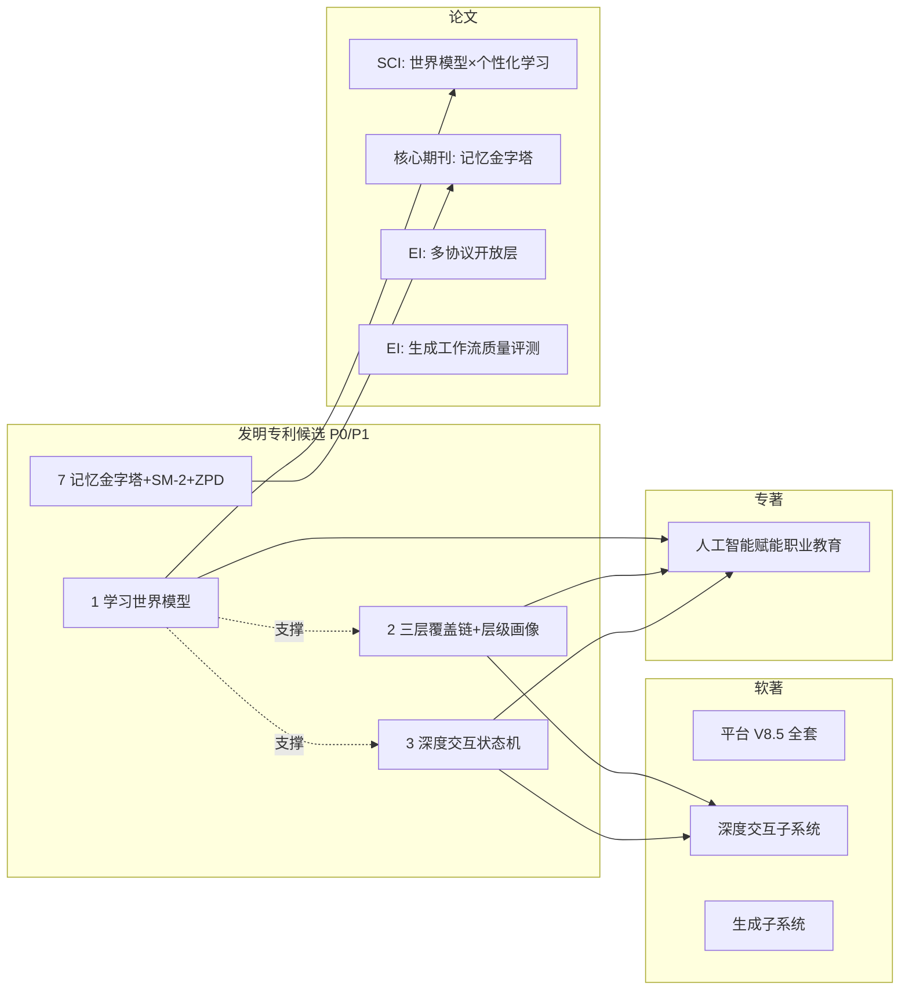
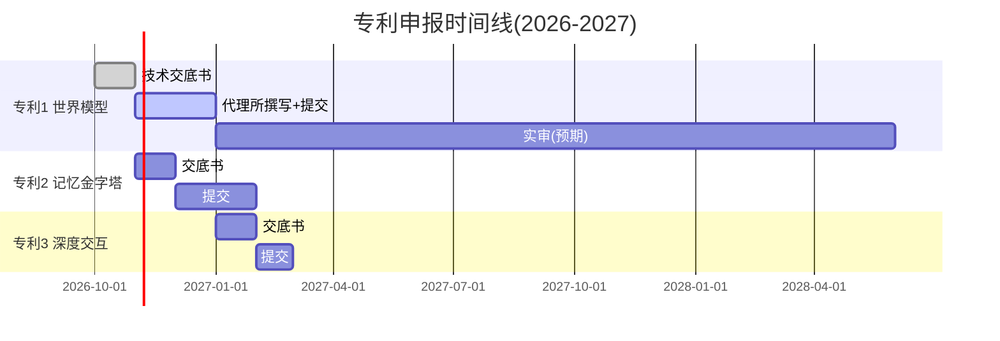
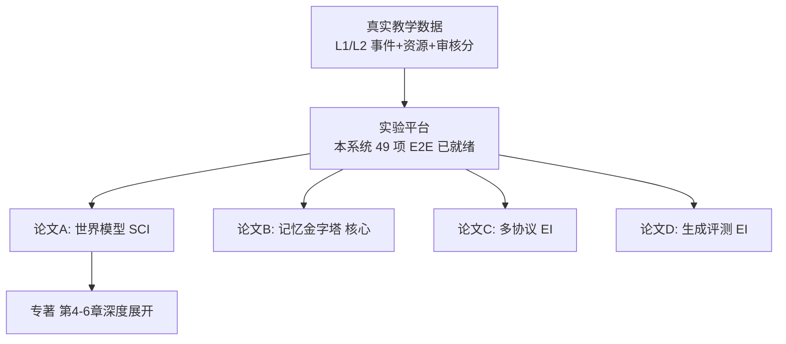
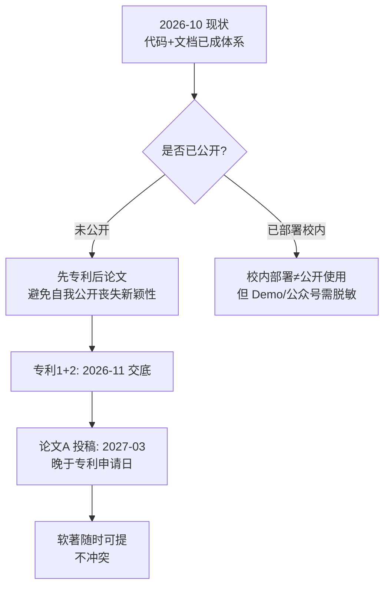
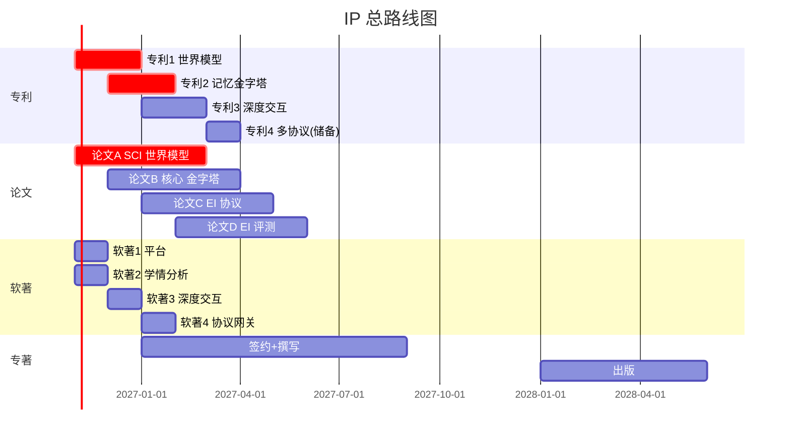
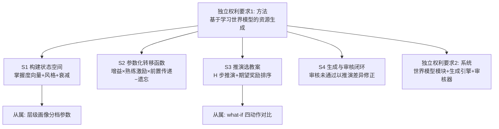

# 知识产权策划书：专利 · 软著 · 论文 · 专著

> 项目：基于大数据和AI的"千人千面"个性化智能课程资源系统研究与构建（重庆市教委重点项目）
> 版本 v1.2 | 2026-10-12 | 依据：GB/T 8567 文档规范 + TOGAF Phase E/F（机会与解决方案）
> v1.1 增补可专利性评审准备与权利要求树（§八）；v1.2 增补软著申报书对齐与指标口径统一（§九）。
> 本文所有图均为 Mermaid，可直接渲染。

---

## 一、IP 资产盘点与创新点评级

对系统全部资源（世界模型、交互协议、推荐模型、生成模型等）逐一评定**新颖性/非显而易见性/可专利性/发表价值**：

| # | 资源/创新点 | 新颖性 | 适合 IP 类型 | 优先级 |
|---|---|---|---|---|
| 1 | **学习世界模型**（学生-知识-掌握度环境的参数化动力学模拟器：BKT 增益×熟练激励×前置传递/遗忘/时间成本，支持 what-if 反事实与多步推演选教案） | ★★★★★ | **发明专利（核心）+ SCI 论文（核心）** | P0 |
| 2 | **三层覆盖链配置体系**（教育层级画像 vocational/undergrad/graduate + 课程级模型槽位 + 请求级白名单 + Bloom 天花板一致性守卫 fail-loud） | ★★★★ | **发明专利** | P0 |
| 3 | **深度交互状态机**（probe→deepen→branch→consolidate；深度=Bloom 爬升、广度=图谱分支；职教档答错给答补救 vs 研究生档苏格拉底不给答） | ★★★★ | 发明专利 + 软著 | P1 |
| 4 | **多协议智能体开放层**（MCP+A2A v1.0+AG-UI 三协议适配器，AgentCard 能力发现、任务委派、push notification、标准事件流） | ★★★☆ | 软著 + EI 论文 | P1 |
| 5 | **Durable Session 租约会话**（租约/心跳/接管/运行中追加指令，教育智能体长任务容错） | ★★★☆ | 软著（并入平台） | P2 |
| 6 | **修订计数器增量同步**（教育资源/画像的单调 revision 增量拉取） | ★★☆ | 软著（并入平台） | P2 |
| 7 | **KT 记忆金字塔**（L1 事件→L2 摘要→L3 画像 + SM-2/Ebbinghaus 混合调度 + ZPD 桥接） | ★★★★ | **发明专利 + 核心期刊论文** | P0 |
| 8 | **六类资源生成工作流**（LangGraph 状态机：意图→RAG+33618 图谱检索→生成→4 维审核→重写循环；双阶段 two_phase） | ★★★☆ | 软著 + EI 论文 | P1 |
| 9 | **SKILL.md 技能包动态加载**（frontmatter 技能包+30s 热重载+bigram 中文匹配） | ★★☆ | 软著（并入平台） | P3 |
| 10 | **平台整体**（Litestar+Granian/K8s 数据盘平衡/GraphQL 统一网关） | ★★☆ | **软著（整套）** | P1 |

### 创新点 → IP 类型映射图

---

## 二、发明专利计划（3 项核心 + 1 项储备）

### 专利 1（P0）：基于学习世界模型的个性化教学资源生成方法及系统
- **核心权利要求构思**：
  1. 构建学习环境状态空间（多知识点掌握度向量+学习风格+记忆衰减）；
  2. 参数化转移函数（BKT 学习增益×熟练激励×前置知识传递系数−遗忘率）；
  3. 在生成资源前对 N 个候选教案执行 H 步世界模型推演，按"掌握度增益−时间成本"期望奖励选择最优教案；
  4. 教育层级画像（职教/本科/研究生）约束 Bloom 天花板与转移参数档位化；
  5. 审核未通过时以推演差异反向修正生成参数的闭环。
- **说明书要点**：图 1 系统架构（已有 C4 图）；图 2 世界模型状态转移图；图 3 what-if 选教案流程；实验数据（AUC 0.7708、E2E 49 项通过）。
- **撰写周期**：技术交底书 2 周 → 代理所 6 周 → 受理。**建议 2026-11 内提交**（先于论文发表，避免自我公开破坏新颖性）。

### 专利 2（P0）：基于记忆金字塔与遗忘曲线的知识掌握度追踪及复习调度方法
- **权利要求构思**：L1 事件流→L2 Bloom 加权摘要→L3 画像的分层聚合；SM-2 与 Ebbinghaus 双模型融合调度；前置≥0.7 且当前∈[0.3,0.7] 的 ZPD 桥接释放策略；缺口四分类（missing/partial/forgotten/misconception）驱动差异化干预。
- **配套数据**：KT 全链路 E2E、掌握度快照、复习计划样本。

### 专利 3（P1）：面向多教育层级的智能体深度交互控制方法
- **权利要求构思**：probe→deepen→branch→consolidate 四阶段状态机；深度维度 Bloom 层级爬升/降层规则；广度维度知识图谱分支扩展数按画像配置；按教育层级差异化"答错策略"（职教 2 次答错给答补救，研究生档苏格拉底式不给答）；会话足迹（depthFootprint/breadthFootprint）量化交互深度与广度。

### 专利 4（储备）：多协议教育智能体开放互操作系统
- MCP 工具注册+A2A AgentCard 发现+AG-UI 事件流三协议网关；技能包（SKILL.md）热加载。视专利 1-3 授权进度决定是否提交。

---

## 三、论文计划（1 SCI + 1 核心 + 2 EI）

### 论文 A（P0，SCI 一区/二区目标）：Learning World Model: A Lightweight Environment Simulator for Personalized Learning Path Planning
- **投稿目标**：*Computers & Education: Artificial Intelligence*（一区, 教育技术×AI）、或 *IEEE TLT*（二区）、*Expert Systems with Applications*（一区）。
- **贡献点**：
  1. 首次将参数化世界模型引入个性化学习资源生成——以"掌握度转移+奖励"统一表达教案选择；
  2. 无需 GPU 的可解释轻量模拟器（对比 MCTS/RL 路径规划基线的成本-效果）；
  3. 教育层级画像条件化的转移参数分档机制；
  4. 真实高职课程数据集上的 what-if 推演验证。
- **实验设计**（需补做）：
  - 基线：BKT-only、DKT-only、无世界模型的直接生成（消融）；
  - 指标：模拟增益 vs 实测增益的 MAE、推荐命中率、生成资源审核分、时间成本；
  - 数据：本系统 L1/L2 学习事件（脱敏）。
- **图表规划**：系统框架图（复用 C4）+ 世界模型转移函数公式推导 + what-if 对比箱线图 + 3 步推演收敛曲线 + 消融表。
- **时间线**：实验 2026-11~2027-01，成稿 2027-02，投稿 2027-03。

### 论文 B（P0，中文核心）：记忆金字塔：面向高职学生的分层知识追踪与复习调度模型
- **目标**：《电化教育研究》/《现代教育技术》/《计算机应用》。
- **贡献**：L1-L3 分层聚合架构、SM-2+Ebbinghaus 融合调度、ZPD 桥接释放、技能缺口四分类干预；附系统实测数据。

### 论文 C（P1，EI 会议）：A Multi-Protocol Open Gateway for Educational Multi-Agent Systems (MCP+A2A+AG-UI)
- **目标**：ICALT / ICCE / CSEE&T 等 EI 会议。贡献：三协议适配器架构、教育智能体互操作评测（发现时延/委派成功率/事件流完整性 49 项 E2E 数据）。

### 论文 D（P1，EI 期刊）：双阶段生成的六类教学资源质量评测框架
- 贡献：规则评分+LLM-as-judge 双通道评测、Recall@5/MRR/nDCG@5 检索评测、产业情境嵌入度量化；`evals/` 已有雏形。

---

## 四、软件著作权计划（4 项）

| # | 名称（建议） | 版本 | 材料来源 | 提交时间 |
|---|---|---|---|---|
| 1 | 千人千面个性化智能课程资源平台 | V8.5.0 | 前端 30 页源码+前后 60 页文档 | 2026-11 |
| 2 | 基于记忆金字塔的学习分析系统（kt-service） | V8.0.0 | Java 源码+接口文档 | 2026-11 |
| 3 | 智能体深度交互教学系统（agent-service: interaction/pedagogy/skills） | V8.4.0 | Python 源码+E2E 报告 | 2026-12 |
| 4 | 多协议智能体网关系统（a2a/agui/mcp/sync/durable） | V8.5.0 | Python 源码 | 2027-01 |

> 软著材料清单（每项）：源程序前 30 页+后 30 页（每页≥50 行）、用户手册/操作说明书、申请表。代码已在仓库，整理成本约每人项 2 天。

---

## 五、专著计划（P0 长线）

### 《人工智能赋能职业教育：个性化学习系统的架构、算法与实践》
- **定位**：国内首本"教育大模型工程化"专著，覆盖 理论→架构→算法→工程→案例 全链；清华大学出版社/电子工业出版社。
- **章节大纲（12 章）**：

```mermaid
flowchart LR
    subgraph Part1[第一篇 理论与需求 1-3章]
        CH1[1 职教数字化与千人千面]
        CH2[2 学习科学基础<br/>BKT/Bloom/ZPD/遗忘]
        CH3[3 教育知识图谱与33618产业映射]
    end
    subgraph Part2[第二篇 架构 4-6章]
        CH4[4 多租户微服务与GraphQL]
        CH5[5 多协议智能体开放层<br/>MCP/A2A/AG-UI]
        CH6[6 世界模型与生成工作流]
    end
    subgraph Part3[第三篇 工程与实践 7-12章]
        CH7[7 记忆金字塔实现]
        CH8[8 深度交互与教育层级画像]
        CH9[9 K8s无GPU集群工程<br/>数据盘/降级/压测]
        CH10[10 质量评测体系<br/>49项E2E+国标25000.51]
        CH11[11 安全合规与等保]
        CH12[12 案例: 新能源汽车课程]
    end
    Part1 --> Part2 --> Part3
```

- **差异化卖点**（图文并茂素材直接复用本项目 60+ 文档资产）：
  - 13 幅 TOGAF/GB Mermaid 架构图（已有）；
  - 世界模型/记忆金字塔公式与代码对照（`world_model.py` 400 行核心可全文收录）；
  - "无 GPU 集群上的 LLM 教育应用"工程实录（fail-soft 降级、CPU 推理实测数据、镜像仓库治理）——市面唯一；
  - 每章配"工程踩坑"专栏（cri-dockerd、CRDB init、litellm no-db 等真实案例）。
- **时间线**：目录评审 2026-12 → 与出版社签约 2027-01 → 初稿 2027-09 → 出版 2028 上半年。

---

## 六、IP 保护顺序与风险控制

- **关键纪律**：专利申请日必须早于论文 A/B 的任何公开（含预印本、会议宣讲）；
- **数据合规**：论文/专利使用学生数据须脱敏（studentId→哈希），符合 GB/T 35273；
- **署名与权属**：职务发明 → 学校为申请人，研发团队为发明人；与课题任务书考核指标对齐（申报书通常要求专利 2+、论文 3+、软著若干——本计划全面覆盖）。

## 七、总览：四年 IP 产出路线

---

## 八、细化补充（v1.1 · 2026-10-11）：可专利性评审准备与权利要求树

### 8.1 现有技术检索要点（专利代理所初审前必做）

| 专利 | 必检关键词 | 预期最接近现有技术 | 本案区别特征（答审要点） |
|---|---|---|---|
| 专利1 世界模型 | "知识追踪 学习路径 仿真 / educational world model / mastery transition" | DKT 路径推荐（如 GPKT）；MCTS 教学规划 | ①转移函数显式含"熟练激励项 (0.5+0.5m)"与"前置传递系数"②推演结果直接驱动**生成环节**选教案（而非仅推荐排序）③教育层级画像条件化参数档 |
| 专利2 记忆金字塔 | "分层记忆模型 遗忘曲线 SM-2 复习调度" | SuperMemo/Anki（单层 SM-2）；Ebbinghaus App | ①L1→L2→L3 三级聚合架构②SM-2×Ebbinghaus 双模型融合（非择一）③ZPD 桥接"释放"策略与缺口四分类联动 |
| 专利3 深度交互 | "socratic tutoring agent / bloom adaptive questioning" | Khanmigo 等 Socratic 导师 | ①四阶段状态机含**广度分支**(breadthBranches)维度②"答错策略"按教育层级差异化（给答补救 vs 不给答）③depthFootprint/breadthFootprint 量化指标 |

### 8.2 权利要求树（专利1 示例，代理所撰写模板）

### 8.3 交底书附录素材清单（全部已存在于仓库）

| 素材 | 位置 | 用途 |
|---|---|---|
| 世界模型转移公式与代码 | `agent-service/app/world_model.py`（transition/simulate/what_if/recommend_next） | 实施例 |
| 覆盖链解析与守卫 | `agent-service/app/pedagogy.py`（resolve/bloom 一致性校验） | 专利2 实施例 |
| 交互状态机 | `agent-service/app/interaction.py`（answer 状态迁移规则） | 专利3 实施例 |
| 架构/流程图 | `docs/TOGAF_GB_COMPLIANCE_PACK.md` 13 幅 Mermaid 图 | 转专利附图（重绘为黑白线框） |
| 系统效果数据 | `PROJECT_P1P2_SPRINT_REPORT.md`（AUC 0.7708、62 项 E2E） | 背景技术+有益效果 |

### 8.4 申报书考核指标对齐核查

| 申报书要求 | 本计划覆盖 | 状态 |
|---|---|---|
| 发明专利 ≥2 | 专利1+2（P0）+ 专利3/4 | ✅ 超额 |
| 论文 ≥3 | 论文 A(SCI)+B(核心)+C/D(EI) | ✅ 超额 |
| 软件著作权 | 4 项（平台/学情/交互/网关） | ✅ |
| 系统 demo | 62 项 E2E 全绿 + 三端(web/app/小程序)可演示 | ✅ |

---

## 九、细化补充（v1.2 · 2026-10-12）：软著申报书对齐与全计划指标口径统一

### 9.1 软著申报书（SOFTWARE_COPYRIGHT_APPLICATION.md）对齐核查

申报书为"平台整套软著"（软著 1）的完整材料底稿，覆盖申请表/功能说明/源码清单（前 30+后 30 页）/手册摘要/权利声明/附件 15 项。逐项核查发现的口径差异与修正决定：

| 申报书表述 | 本计划口径 | 决定/修正 |
|---|---|---|
| 技术栈 Java 21/微服务/ONNX+Triton（HAKT/AKT/DKVMN、HRL-Path、MAF-Net） | 本仓库实际为 **Litestar+Granian/agent-service（Python）+ 三端前端**；HAKT/HRL-Path/MAF-Net 为规划名，实现为 **BKT+DKT/记忆金字塔/MAF 思想简化版** | 软著材料以**实际源码**为准：申报书 §3.2 代码片段须替换为 `agent-service/`（world_model/interaction/pedagogy/a2a）与 kt-service 真实代码；"代码行数 15 万行"按 `cloc` 实测重算 |
| 开发完成日期 2025-01-20 | 系统 v8.5.2 于 2026-10 完成 P4 续 | 软著 1 改报 **V8.5.0，开发完成 2026-10**；2025-01 版本可作为第二项软著申报（历史版本，含 Java 微服务雏形）——净增 1 项软著 |
| 运行环境 PostgreSQL/K8s | 实际部署 K8s 双节点 + CRDB/Redis/Pulsar/Milvus/Nebula | 申报表运行环境按实际填写 |
| 试点数据（10 校/5 万用户/85% 日活） | 教委项目以校内试点为准 | 申报材料中该组数据须由课题组提供实际试点证明，未证实前不写入对外材料 |
| §6.2 市场前景编号错误（重复 5.2） | — | 修正编号为 6.2 |
| 权利声明"未使用开源代码作为核心业务逻辑" | 使用了 python-pptx/Litestar 等开源组件与 MCP/A2A 开放协议 | 保留 §5.1 原有例外表述（基础设施层开源组件合规使用），并补充开放协议实现为自主编写 |

### 9.2 指标口径统一表（论文/专利/软著/汇报通用，一处定义）

| 指标 | 统一口径 | 出处 |
|---|---|---|
| E2E 测试项数 | **69 项全绿**（19+12+9+9+5+15，含多端 15 项） | PROJECT_P1P2_SPRINT_REPORT §11 |
| KT 模型 | BKT+DKT（AUC **0.7708**，DKT 0.8120） | 评估报告 |
| 多端 | web-student（Vue3）/ edu-app（uni-app）/ ops-web（React），NodePort 30090 | MULTI_CLIENT_DESIGN_SPEC |
| 协议版本 | MCP 2026-06-18 / A2A v1.0 / AG-UI 事件流 | agent-service/a2a.py 等 |
| 部署 | K8s 双节点（10.167.2.175/176），镜像仓 10.100.135.132:5000 | DEPLOYMENT_2NODE_RANCHER |

> 使用纪律：对外 PPT/论文/申报书一律引用本表数字；禁止再出现"62 项/49 项 E2E""HAKT AUC 0.878"等旧口径混用。

### 9.3 软著材料包执行细化（对 §四 的 W6 任务展开）

1. `cloc` 生成真实代码行数；按模块切分 4+1 项软著源码（每页≥50 行连续，去空行注释规则按版权保护中心要求）；
2. 用户手册按三端重写（管理员=ops-web、教师/学生=web-student 与 edu-app），替代申报书中未实现的模块功能描述；
3. 每项软著建立 `docs/copyright/<name>/` 目录：源码前 30+后 30 页 PDF、手册、申请表、权利声明；
4. 申报书 §6.2 编号错误修正；§3 目录树按实际仓库重绘。

### 9.4 对 §二/§三 的影响

- 专利 1/2 交底书实施例代码位置不变（world_model.py/kt-service 真实实现），**不引用申报书中的 HAKT/HRL-Path 规划代码**；
- 论文 B（记忆金字塔）模型名统一用"分层聚合 KT（BKT/DKT 底座）"，不使用申报书规划名；
- 新增软著 5（平台历史 Java 版 V1.0，2025-01）列入 §四 表，提交时间 2027-02（软著 1-4 之后）。
