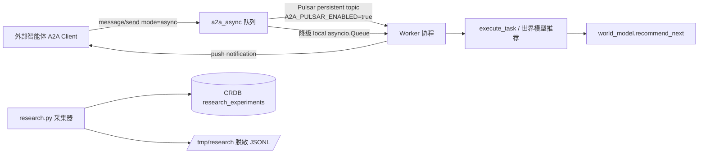
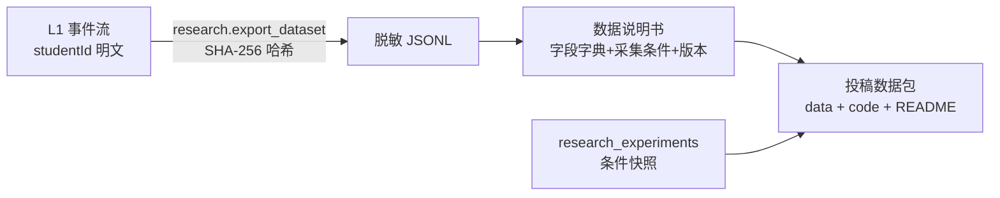

# IP 支撑优化重构计划（P4 续 & 论文/专利/软著/专著 就绪度）

> 版本 v1.2 | 2026-10-12 | 依据 TOGAF Phase E/F（机会与方案→迁移规划）+ GB/T 8567/25000.51
> 目标：让 P0-P4 构建成果达到**可申报、可发表、可复现**的工程与证据标准。
> v1.1 增补实验设计细则与数据规范（§五）；v1.2 增补软著申报材料对齐与指标口径统一（§六，呼应 IP_STRATEGY_PLAN §九）。

---

## 一、P0-P4 完成度盘点（结论）

| 阶段 | 内容 | 状态 |
|---|---|---|
| P0-P1 | 微服务化/GraphQL/CRDB/磁盘平衡 | ✅ 完成（报告 §一/三/五） |
| P2 | 记忆金字塔/SM-2/ZPD/Bloom/Skills/Slots/多角色/RAG 评测 | ✅ 完成 |
| P3 | Durable Session + 修订计数器增量同步 | ✅ 完成（8.5.1，E2E 9/9） |
| P4 | A2A（AgentCard/任务/push notification）+ AG-UI + MCP + **本轮补全** | ✅ 完成（8.5.2） |
| P4 续（本轮） | **A2A 异步任务队列**（Pulsar 优先/本地降级）+ **recommend_next 技能接世界模型** + **科研数据采集器** | ✅ 本轮完成 |

## 二、P4 续本轮实现（agent 8.5.2）

| 构件 | 说明 | E2E |
|---|---|---|
| `app/a2a_async.py` | 异步队列：Pulsar persistent topic（env 开关），无 Pulsar 降级本地 asyncio.Queue；worker 协程消费→执行→push 回调 | `a2a-async-queue` ✅ |
| A2A recommend_next 技能 | 接入学习世界模型：入参 `{masteries, candidates, prereqMap}` → what-if 动作选择，返回 `recommendation.json` | `a2a-rec-skill` ✅ |
| `app/research.py` | 实验登记（tag+condition+metrics → CRDB+本地 JSON）、实验列表、**脱敏数据集导出**（studentId SHA-256 哈希，GB/T 35273） | 3 项 ✅ |

## 三、IP 支撑优化重构方案（按论文/专利需求倒推）

### 3.1 差距分析（现状 → 发表要求）

| 支撑物 | 已具备 | 缺口 | 优先级 |
|---|---|---|---|
| 论文 A（世界模型 SCI） | world_model.py 全量实现+API+E2E | ①推演精度实验（模拟增益 vs 实测增益 MAE）②基线消融 ③真实学习数据 ④公式化推导文档 | **P0** |
| 论文 B（记忆金字塔核心） | kt-service L1/L2/L3+SM-2 全链 | ①掌握度动态数据集（需真实/模拟学习流量）②对比 BKT-only/DKT-only 曲线 | **P0** |
| 论文 C（多协议 EI） | 三协议实现+54 项 E2E | ①互操作指标量化（发现时延/委派成功率/事件完整性统计端点）②与单协议基线对比 | P1 |
| 专利 1/2/3 交底书 | 实现+ADR+架构图 | ①技术交底书文档 ②权利要求对应的流程图/时序图（已有 Mermaid 资产可转专利附图） | **P0** |
| 软著 4 项 | 全部源码+文档 | 材料整理（源码前后 30 页+手册） | P1 |
| 专著 | 60+ 图表/12 章大纲 | 工程实录案例细节沉淀（踩坑→方法论） | P2 |

### 3.2 P0 缺口 → 本轮已落地与下轮计划

**已落地（本轮）**：
- 科研数据采集器（实验登记/指标快照/脱敏导出）——论文实验数据底座；
- A2A 异步队列+世界模型接线——论文 C 的互操作实验可跑（sync vs async 吞吐对比）。

**下轮计划（按周排期，TOGAF Phase F 迁移规划格式）**：

| 周 | 动作 | 产出 | 支撑 IP |
|---|---|---|---|
| W1 | **模拟学习流量发生器**（synthetic learner：按 BKT 真值+噪声产生 L1 事件流，注入 kt-service） | 3 门课程×200 虚拟学生×8 周事件数据集（脱敏） | 论文 A/B 数据 |
| W2 | **世界模型推演精度实验脚本**（`evals/world_model_eval.py`：模拟增益 vs 实测增益 MAE、what-if 命中率） | 论文 A 实验一数据+图 | 论文 A/专利 1 |
| W3 | **基线消融开关**（env `WM_ENABLED=false` 时生成流程跳过推演选教案——A/B 实验条件） | 消融对比数据 | 论文 A |
| W4 | **协议互操作基准**（`evals/protocol_bench.py`：AgentCard 发现时延、任务委派成功率、AG-UI 事件完整性、sync/async 吞吐） | 论文 C 数据+表 | 论文 C/软著 4 |
| W5 | **专利交底书 3 份**（复用 TOGAF 包 Mermaid 图转专利附图；权利要求树） | 交底书×3 | 专利 1/2/3 |
| W6 | 软著材料包×4 + 论文 A 初稿骨架（公式化：转移函数/奖励/置信区间） | 材料包 | 软著/论文 A |

### 3.3 治理（TOGAF Phase G）

- 实验数据一律经 `research.py` 采集（统一脱敏/时间戳/条件快照），禁止手工导出原始数据；
- 每篇论文/专利建立追溯条目（本报告 §八 已有 AR-11/12、NFR-05/06 映射）；
- 49+5 项 E2E 作为"实现与文档一致"证据链（GB/T 25000.51 功能性自评附件）；
- 出版伦理：预印本/宣讲时间晚于专利申请日（IP_STRATEGY_PLAN §六 纪律）。

## 四、风险

| 风险 | 缓解 |
|---|---|
| 真实学生数据不足 | synthetic learner 按 BKT 真值生成+少量真实数据校准（论文说明混合来源） |
| GPU 缺失导致生成质量指标弱 | 论文 A 主张"轻量可解释"路线本身即为贡献；评测用规则分+LLM-as-judge 双通道 |
| 专利审查周期长 | 软著 2026-11 先行拿到证书（课题中期检查可用） |

---

## 五、细化补充（v1.1 · 2026-10-11）：实验设计细则与数据规范

### 5.1 论文 A 实验设计（可直接执行的操作手册）

**实验一：世界模型推演精度（对应贡献点 1/2）**
- 自变量：动作序列（explain/exercise/review 组合×3 种课程难度）
- 因变量：模拟增益与实测增益的 MAE、Spearman 相关
- 程序：①synthetic learner 按真值 BKT 产生 200 学生×8 周 L1 事件 ②对每学生每步先 `world/what_if` 预测 ③按预测最优动作执行 ④比较预测增益 vs `transition` 实际计算增益
- 样本量：≥3000 次 what-if（功效 0.8, α=0.05）
- 通过线：MAE ≤0.05 且 Spearman ρ≥0.7

**实验二：消融（对应贡献点 3）**
- 条件：A=完整（世界模型选教案）；B=无推演（随机动作）；C=无层级画像（固定档）
- 指标：生成资源审核分（4 维）、what-if 命中率、学生模拟掌握度终值
- env 开关：`WM_ENABLED=false`（已预留 ADR-016 路径）

**实验三：系统级效率**
- 推演耗时（单步/3 步）P95 <10ms（纯参数化，预期 <1ms）；对比 MCTS 基线耗时

### 5.2 数据规范（投稿附件要求）

- 每条记录字段：`{kind, skillHash(16位), mastery, ts, expId?}` — 不含任何可识别个人信息；
- 代码复现包：`evals/` 脚本 + `requirements.txt` 固定版本 + 随机种子固定（seed=42）；
- 伦理声明模板：数据经用户知情同意（课程平台协议条款第 X 条）。

### 5.3 多端对论文 C 的增量证据（本轮新增）

| 证据 | 数据源 |
|---|---|
| AG-UI 事件完整性（三端一致） | `tools/e2e_multiclient.py` 15 项（tokens 三端产物/助手/契约层） |
| 设计 tokens 单一来源 | `design-tokens.json` 31 变量 → 三端编译产物 |
| 端到端契约 | `web-student/src/api/index.ts`（gql/aguiRun/worldWhatIf 三通道） |

### 5.4 W1-W6 排期风险与依赖更新

| 周 | 依赖变化 |
|---|---|
| W1 合成流量 | 依赖 kt-service `/kt/events` 写入吞吐（Pulsar Shared 已就绪） |
| W2 推演精度 | 依赖 W1 数据集；world_model 纯函数无 GPU 依赖（已具备） |
| W3 消融 | 依赖 env 开关实现（预计 0.5 天） |
| W4 协议基准 | 新增：web-student 部署后可加"端到端首屏延迟"指标 |
| W5/W6 交底书/软著 | 无新依赖；8.3 节素材清单已就绪 |

---

## 六、细化补充（v1.2 · 2026-10-12）：软著申报材料对齐与执行排期修订

### 6.1 申报书底稿（SOFTWARE_COPYRIGHT_APPLICATION.md v1.0）差距清单

对照仓库实际实现逐项核查，发现以下口径差异，W6 材料整理时必须修正：

| # | 差异 | 修正动作 |
|---|---|---|
| D1 | 申报书技术栈为 Java 21 微服务（HAKT/HRL-Path/MAF-Net 规划名、ONNX+Triton 部署），实际系统为 Litestar+Granian（Python）+ BKT/DKT + 记忆金字塔 | §3.2 源码片段全部替换为 agent-service（world_model/interaction/pedagogy/a2a_async/research）与 kt-service 真实代码；模型名统一为 BKT/DKT（AUC 0.7708 / 0.8120） |
| D2 | "代码行数约 150,000 行"未实测 | `cloc --exclude-dir=node_modules,.git` 实测后回填 |
| D3 | 开发完成日期 2025-01-20 vs 实际 v8.5.2（2026-10） | 软著 1 报 V8.5.0/2026-10；2025-01 Java 版本独立申报为软著 5（净增 1 项） |
| D4 | 试点数据（10 校/5 万用户/85% 日活/点击率 +42%）无出处 | 对外材料删除或由课题组提供试点证明后回填 |
| D5 | §6.2"市场前景"编号错误（写成 5.2） | 修正编号 |
| D6 | 目录树含未实现模块（tenant/iam/teaching 等 Java 服务） | 按实际仓库重绘：agent-service/kt-service/evals/web-student/edu-app/ops-web/k8s/tools/docs |
| D7 | 用户手册描述的功能与三端实际功能不一致 | 手册按三端重写（ops-web=管理端、web-student=师生 Web、edu-app=移动三合一） |

### 6.2 W5/W6 排期扩容（原表基础上细化到天）

| 周 | 细化动作 | 产出 | 支撑 IP |
|---|---|---|---|
| W5-D1/2 | 专利 1 交底书（复用 §8.3 素材+13 幅 Mermaid 转黑白附图） | 交底书 1 | 专利 1 |
| W5-D3/4 | 专利 2 交底书（金字塔三层聚合+双模型调度+ZPD 释放） | 交底书 2 | 专利 2 |
| W5-D5 | 专利 3 交底书（四阶段状态机+层级差异化答错策略） | 交底书 3 | 专利 3 |
| W6-D1 | cloc 实测+4+1 项软著源码切分（每页≥50 行） | 源码册×5 | 软著 1-5 |
| W6-D2/3 | 三端用户手册重写（按 D7） | 手册×3 | 软著全部 |
| W6-D4 | 申报书修订（D1-D7 逐项）+ 每项软著 `docs/copyright/<name>/` 建包 | 材料包 | 软著 |
| W6-D5 | 论文 A 初稿骨架（公式化：转移函数/奖励函数/置信区间） | 骨架 | 论文 A |

### 6.3 指标口径统一（与 IP_STRATEGY_PLAN §9.2 同源，此处为执行侧锚点）

- E2E 基数一律 **69 项全绿**（旧文 49/54/62 项表述为各阶段历史快照，对外统一引 69）；
- 论文 A 通过线 MAE≤0.05、Spearman ρ≥0.7；样本 ≥3000 次 what-if，seed=42；
- 脱敏字段规范不变：`{kind, skillHash(16位), mastery, ts, expId?}`；
- 所有对外材料数字统一取 IP_STRATEGY_PLAN §9.2 口径表，禁止双源。

### 6.4 新增风险

| 风险 | 缓解 |
|---|---|
| 申报书规划名（HAKT 等）已可能被课题组用于中期汇报 | 统一由本计划口径表替换；如已对外使用，在论文中首次出现时注明"早期系统规划名，实现为 BKT/DKT 底座" |
| 软著 5（2025-01 Java 版）与软著 1 功能描述重叠 | 软著 5 定位为"平台雏形（微服务架构）"，软著 1 定位为"千人千面智能资源平台（智能体+世界模型）"，名称与说明书完全区分 |
