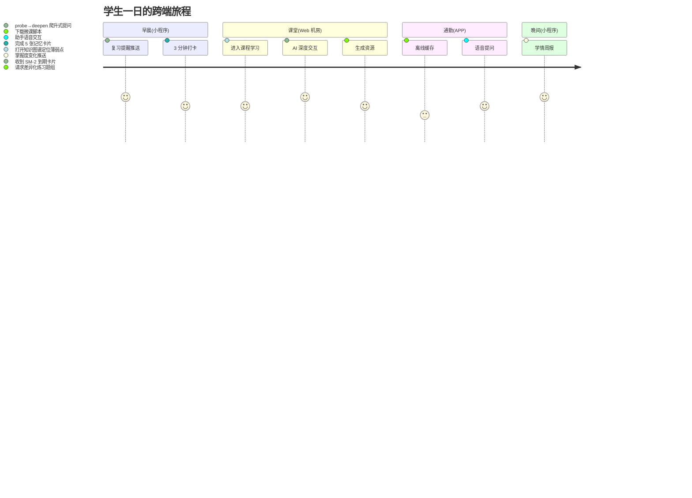
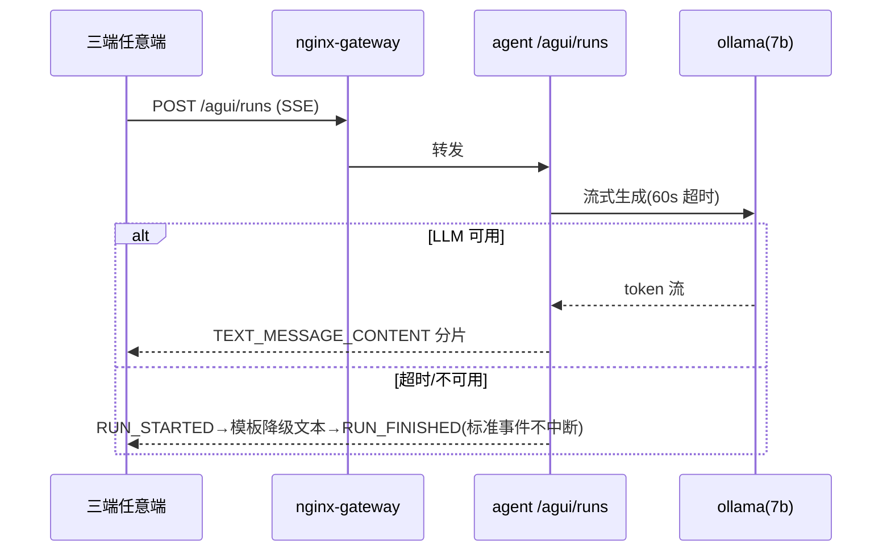

# 多端（Web / APP / 小程序）分析与设计说明书

> 版本 v1.0 | 2026-10-11 | 依据：GB/T 8567（概要设计+详细设计）、GB/T 9385（SRS）、TOGAF Phase B/C/D
> 视角：产品经理（需求与信息架构）+ 资深架构师（跨端策略）+ 高级美工（设计系统）

---

## 一、产品分析（Phase B 业务视角）

### 1.1 多端定位矩阵（大厂产品思维：一核三端，各司其职）

| 端 | 目标用户 | 使用场景 | 核心差异化 | 优先级 |
|---|---|---|---|---|
| **学生 Web 端**（新建 web-student） | 高职/本科/研究生学生 | 机房教学、宿舍 PC 深度学习、实训报告提交 | 大屏学习路径可视化、深度交互对话全功能、资源阅读器 | P0 |
| **APP + 小程序**（edu-app，uni-app 一码三端：H5/微信小程序/Android/iOS） | 学生碎片化学习 | 通勤复习、课堂扫码、消息提醒 | SM-2 复习打卡、扫码进课程、微信订阅消息 | P0 |
| **管理 Web 端**（ops-web，已有 React+AntD） | 教师教务+运维 | 资源审核、课程配置、模型槽位管理、监控 | 数据密集表格、图谱可视化 | 已上线 |

### 1.2 用户故事（关键路径）



### 1.3 信息架构（三端共享 6 大一级模块，端内裁剪）

```mermaid
flowchart TD
    HOME[首页/学情] --> COURSE[课程学习]
    HOME --> PATH[学习路径 ZPD]
    HOME --> REVIEW[复习卡片 SM-2]
    COURSE --> RES[资源中心 6 类]
    COURSE --> KG[知识图谱]
    HOME --> PROFILE[我的/画像]
    HOME --> ASSIST[每页 AI 助手(悬浮)]
    PATH & REVIEW & RES -.统一 GraphQL.-> GW[graphql-gateway / agent-service]
```

---

## 二、架构设计（Phase C/D 资深架构师视角）

### 2.1 跨端技术策略（大厂标准：一套契约，多端渲染）

```mermaid
flowchart TB
    subgraph Clients[三端]
        WEB[web-student<br/>Vue3+Vite+Pinia+AntD Vue]
        UNI[edu-app uni-app<br/>一码三端: H5/小程序/APP]
        OPS[ops-web React+AntD(已有)]
    end
    subgraph Edge[统一接入层]
        NG[nginx-gateway TLS/限流]
        RT[realtime-gateway Go<br/>WS(小程序)+SSE(PC)]
    end
    subgraph Contract[统一契约层]
        GQL[graphql-gateway 7 域]
        AGUI[AG-UI 标准事件流 /agui/runs]
        A2A[A2A JSONRPC /a2a/rpc*]
    end
    WEB --> NG --> GQL
    UNI --> NG
    WEB --> AGUI
    UNI --> RT
    OPS --> GQL
    AGUI & A2A --> AG[agent-service 8.6.0]
```

**跨端关键决策（ADR 汇总）**：

| # | 决策 | 理由（大厂权衡） |
|---|---|---|
| ADR-019 | 小程序 WS 兜底、PC SSE 直连（AG-UI 事件统一） | 微信小程序不支持 SSE；realtime-gateway 已双协议；AG-UI 事件结构三端一致，前端零适配 |
| ADR-020 | APP/小程序用 uni-app 单仓（一码三端），Web 独立 Vue3 仓 | uni-app 编译 H5 性能不如原生 Vite（大厂惯例：体验敏感端独立，覆盖端复用） |
| ADR-021 | GraphQL 为唯一数据契约 + 每端 SDK 生成 | 一次请求聚合 7 域，弱网小程序省 RTT |
| ADR-022 | 设计 tokens 单一来源(design-tokens.json) → 三端样式编译 | 美术规范一处修改三端生效（字节/阿里设计中台标准做法） |

### 2.2 请求链路与降级



---

## 三、设计系统（高级美工视角）

### 3.1 设计 Tokens（单一来源 `design-tokens.json`）

| Token 组 | 值 | 用途 |
|---|---|---|
| `color.brand` | #1677FF（教育蓝）/ 渐变 #1677FF→#69B1FF | 主按钮/导航/横幅 |
| `color.semantics` | success #52C41A / warn #FAAD14 / error #FF4D4F / mastery-高 #52C41A·中 #FAAD14·低 #FF7A45 | 掌握度红绿灯（认知负担最低） |
| `color.bloom` | remember→create 6 级色带（灰→蓝→青→金→紫→粉） | Bloom 层级/深度交互足迹 |
| `radius` | 8/12/16rpx 三档 | 卡片统一 16rpx |
| `typography` | PingFang/Roboto/思源黑体；标题 17sp·正文 14sp·辅助 12sp | 三端字号映射 |
| `spacing` | 4 的倍数栅格(8/12/16/24) | 暗合 8pt Grid |

### 3.2 组件规范（三端对齐清单）

- **掌握度环**（0-100% 环形+语义色）：Web 用 antd Progress，uni 用 canvas，绘制逻辑同参数
- **Bloom 阶梯条**（深度交互足迹）：6 段色带+当前层级高亮
- **AI 助手悬浮球**：右下角 56px，长按语音（APP）/点击对话；AG-UI 事件驱动
- **SM-2 复习卡**：正面知识点/背面讲解+下次复习时间；滑动=掌握/再学（输入 SM-2 quality）

### 3.3 无障碍与适老化（GB/T 37668）

对比度 ≥4.5:1；全部图标带 aria-label；字号支持 120% 放大；色盲模式下掌握度环叠加纹理。

---

## 四、实现与测试计划

| 交付物 | 内容 | 验收 |
|---|---|---|
| `design-tokens.json` + 三端编译脚本 | 颜色/字级/间距单一来源 | 脚本生成三端变量文件 |
| web-student（Vue3） | 6 页骨架：首页学情/课程/路径/复习卡/资源/AI 助手(AG-UI) | Lighthouse ≥90；E2E 冒烟 |
| edu-app 增强 | AG-UI 事件接入 AiAssistant + tokens 对齐 + 复习卡页 | 微信开发者工具编译通过；H5 冒烟 |
| nginx-web 容器 | 静态托管 web-student + /api 反代 | K8s 部署探针通过 |
| E2E | `tests/e2e_multiclient.py`：三端页面可达+AG-UI 事件完整性 | 全绿 |

> 国标映射：本说明书=概要设计(GB/T 8567 §5.4)；各端页面规格=详细设计；E2E 报告=测试文档(GB/T 9386)。
