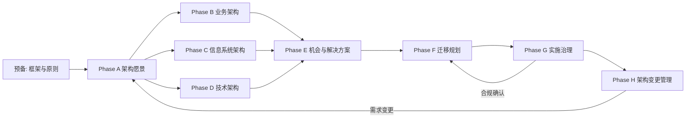
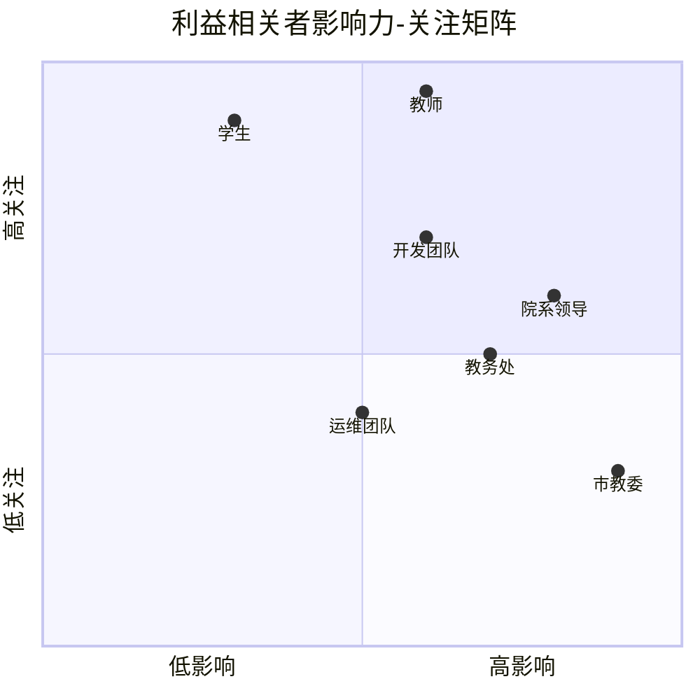
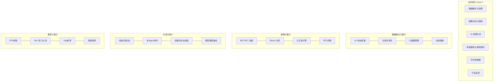
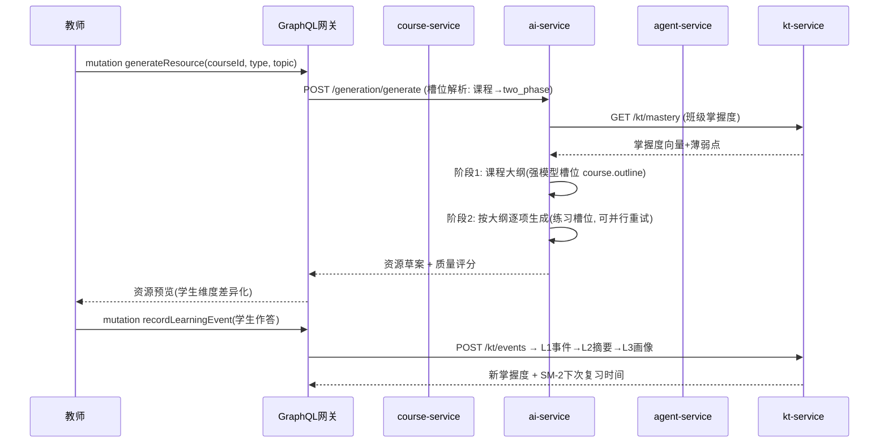
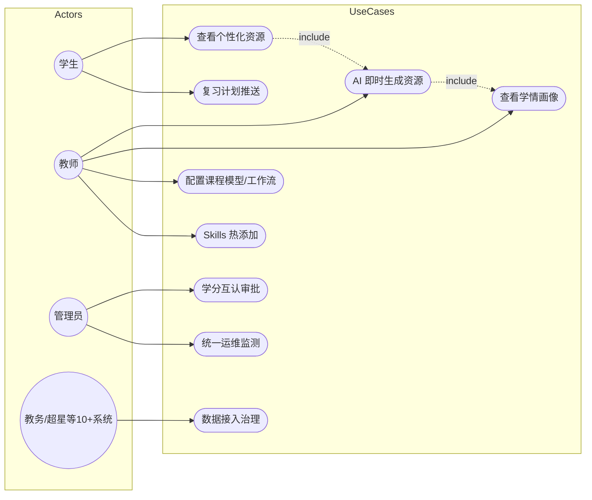
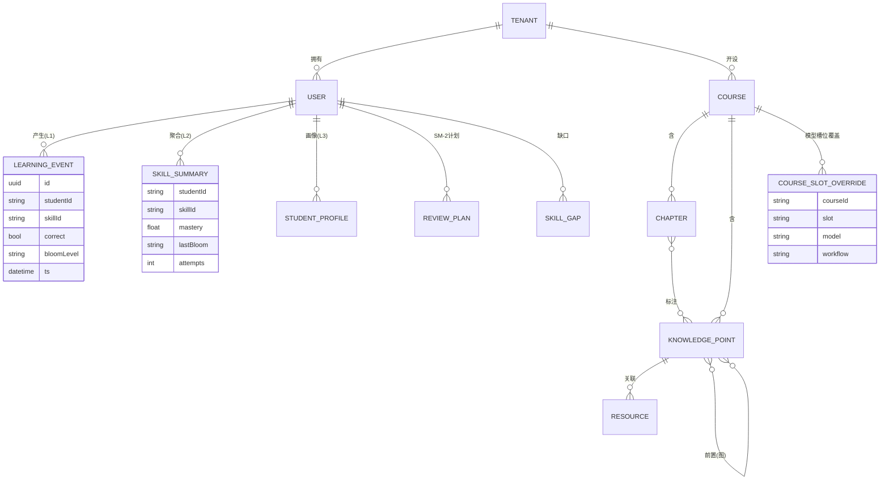
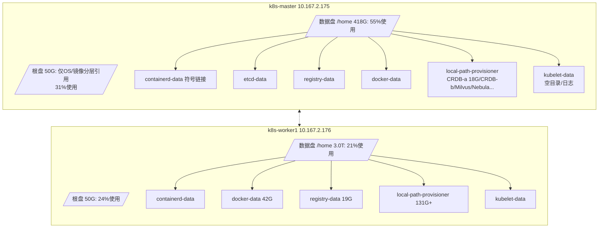
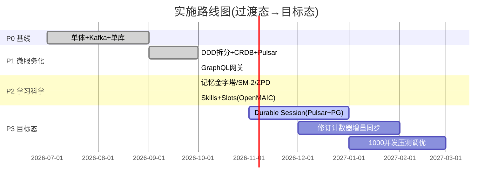
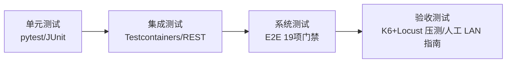

# 千人千面个性化智能课程资源系统 — 软件工程国标 & TOGAF 完整资料集

> 版本: v8.1 | 日期: 2026-10-11
> 项目: 基于大数据和AI的"千人千面"个性化智能课程资源系统研究与构建（重庆市教委重点项目）
> 本文依据 **TOGAF 10 ADM** 架构方法组织，并映射 **GB/T 软件工程国标** 全套文档体系。所有图表使用 Mermaid（可在支持 GFM 的查看器中直接渲染）。

---

## 目录

1. [TOGAF ADM 总体路线图](#一togaf-adm-总体路线图)
2. [Phase A: 架构愿景](#二phase-a-架构愿景)
3. [Phase B: 业务架构](#三phase-b-业务架构)
4. [Phase C: 信息系统架构(数据+应用)](#四phase-c-信息系统架构)
5. [Phase D: 技术架构](#五phase-d-技术架构)
6. [Phase E/F: 机会与解决方案 + 迁移规划](#六phase-ef-机会与解决方案迁移规划)
7. [Phase G: 架构治理](#七phase-g-架构治理)
8. [国标文档体系映射(GB/T 8567/9385/15532/25000.51 等)](#八国标文档体系映射)
9. [关键 ADR 决策记录](#九关键-adr-决策记录)
10. [需求追溯矩阵(SRS ↔ 设计 ↔ 实现 ↔ 测试)](#十需求追溯矩阵)
11. [测试与质量报告](#十一测试与质量报告)
12. [部署视图与运维手册索引](#十二部署视图与运维手册)

---

## 一、TOGAF ADM 总体路线图



**本项目 ADM 执行状态：**

| ADM 阶段 | 关键交付物 | 位置 | 状态 |
|---|---|---|---|
| 预备 | 架构原则、工具基线 | 本文 §九 ADR | ✅ |
| A 愿景 | 利益相关者地图、关键需求 | §二 | ✅ |
| B 业务架构 | 业务能力图、价值流、用例 | §三 | ✅ |
| C 信息系统 | 逻辑/物理数据模型、应用交互矩阵、GraphQL 契约 | §四 | ✅ |
| D 技术架构 | 运行时视图、部署图、技术标准 | §五 | ✅ |
| E/F 机会与迁移 | P0→P3 路线图、过渡态 | §六 | ✅ |
| G 治理 | ADR、合规评审、E2E 门禁 | §七/§九/§十一 | ✅ |
| H 变更管理 | 需求追溯矩阵驱动 | §十 | ✅ |

---

## 二、Phase A 架构愿景

### 2.1 利益相关者与关注点



### 2.2 关键架构需求（驱动约束）

| ID | 需求 | 量化指标 | 来源 |
|---|---|---|---|
| AR-01 | 推荐精准率 | ≥85% | 申报书考核指标 |
| AR-02 | 6 类资源 AI 生成 | 练习题/讲解/实训任务书/微课脚本/视频/知识点讲解 | 申报书 |
| AR-03 | 生成时效 | 日均 AI 生成响应 ≤30s | 申报书 |
| AR-04 | 多租户并发 | 多地区多高校、1000 并发 | 用户新增 |
| AR-05 | 数据底座 | 打通 10+ 业务系统 | 申报书 |
| AR-06 | 知识追踪精度 | BKT+DKT AUC≥0.77(实测 0.7708) | 本项目 |
| AR-07 | 全端覆盖+每页 AI 助手 | 手机 App/小程序/PC | 用户新增 |
| AR-08 | 可观测性 | Grafana 统一监测缓存/MQ/服务/资源 | 用户新增 |

### 2.3 架构原则（Phase 预备产出）

| # | 原则 | 说明 |
|---|---|---|
| P1 | 复用优先 | 集群既有 Redis Cluster/CRDB/Pulsar/LiteLLM 不重建 |
| P2 | GraphQL-first | 对外 API 统一走 graphql-gateway，REST 仅内部 |
| P3 | 每租户隔离 | X-Tenant-Id 全链路透传 + 每租户限流 |
| P4 | Fail-loud | 配置错误启动即失败并指明字段(OpenMAIC 语义) |
| P5 | 模型可插拔 | 任务级槽位路由，课程可覆盖，密钥不出服务端 |
| P6 | 高性能语言按需选型 | Go(实时网关)/Rust(重排)/Python(智能体)/Java(业务) |
| P7 | 一切可观测 | Micrometer→Prometheus→Grafana，日志集中 |

---

## 三、Phase B 业务架构

### 3.1 业务能力地图（Level 1-2）



### 3.2 核心价值流（教师布置个性化作业）



### 3.3 用例图（UML，面向申报书 5 大研究内容）



---

## 四、Phase C 信息系统架构

### 4.1 应用组件交互图（C4 容器级）

```mermaid
flowchart TB
    subgraph Clients[多端前端]
        APP[手机App]
        MP[微信小程序]
        PC[PC Web]
    end
    subgraph Edge[边缘层]
        NG[nginx-gateway<br/>TLS/路由]
        RT[realtime-gateway<br/>Go 1.26 WS+SSE]
    end
    subgraph Gateway[统一API]
        GQ[graphql-gateway<br/>Spring GraphQL 7域]
    end
    subgraph Domain[领域服务 Java 21/25]
        TEN[tenant-service]
        IAM[iam-service]
        CRS[course-service]
        TEA[teaching-service]
        OPS[ops-service<br/>运维监测]
    end
    subgraph AIPlane[智能体平面 Python Litestar+Granian]
        AG[agent-service<br/>LangGraph+Skills+Slots+MCP]
        AIS[ai-service<br/>RAG生成]
        KTS[kt-service<br/>BKT/DKT+记忆金字塔]
        RR[vector-reranker<br/>Rust RRF+MMR]
    end
    subgraph Storage[存储与中间件(集群复用)]
        CRDB[(CockroachDB×3<br/>tenant/iam/course/teaching_db)]
        RC[(Redis Cluster<br/>dify-plus redis8)]
        PS[(Pulsar 4.0.5<br/>领域事件)]
        MV[(Milvus 2.6.6<br/>向量)]
        NB[(Nebula 3.8.3<br/>知识图谱)]
        LLM[LiteLLM :4000<br/>模型网关]
    end
    APP & MP & PC --> NG --> GQ
    NG --> RT
    GQ --> TEN & IAM & CRS & TEA & OPS
    GQ --> AG & AIS & KTS
    AG & AIS --> LLM
    AIS --> MV & RR
    AG <--> KTS
    KTS --> RC
    TEN & IAM & CRS & TEA --> CRDB
    TEN & IAM & CRS & TEA & KTS --> RC
    CRS & KTS & AIS --> PS
    CRDB -.-> NB
```

### 4.2 数据架构：核心实体关系



### 4.3 数据流：学习事件 → 记忆金字塔 → 个性化反馈

```mermaid
flowchart LR
    A[学生作答] -->|X-Tenant-Id| B[GraphQL Gateway]
    B --> C[kt-service /kt/events]
    C --> D[(L1 事件流<br/>JSONL/Pulsar)]
    C --> E[L2 会话摘要<br/>Bloom加权掌握度]
    E --> F[(L3 画像<br/>风格+直方图)]
    F --> G[ZPD Bridge<br/>前置≥0.7 且当前∈0.3~0.7]
    F --> H[SM-2调度<br/>R=e^(-t/S)]
    F --> I[Gap检测<br/>missing/partial/forgotten/misconception]
    G & H & I --> J[个性化推荐/复习/警示]
```

### 4.4 GraphQL 统一契约（对外 API 形态）

| 域 | Query 示例 | Mutation 示例 |
|---|---|---|
| Tenant | `tenants(size:5){id code name}` | `createTenant(code,name)` |
| User | `users(tenantId){id roles{name}}`(BatchMapping) | `createUser(...)` |
| Course | `course(id){chapters knowledgePoints{mastery(studentId)}}` | — |
| Teaching | `learningPaths(courseId){steps}` | — |
| KT | `mastery/memoryProfile/reviewPlan/skillGaps` | `recordLearningEvent` |
| AI | `generatedResource(id)` | `generateResource(...)` |
| Ops | `serviceHealth/cacheStats` | — |

---

## 五、Phase D 技术架构

### 5.1 运行时技术栈（全部为当前主流稳定版）

| 层 | 技术 | 版本 | 选型理由 |
|---|---|---|---|
| 业务服务 | Spring Boot + JDK | 3.5.6 / 编译21运行25 | DDD 四层+JPA+Resilience4j |
| 统一 API | Spring GraphQL | 2.0.4 | Schema-first+DataLoader |
| 智能体 | Litestar + Granian | 2.24 / 2.8 | 全异步 ASGI，Rust 运行时高吞吐 |
| 编排 | LangGraph | 0.4 | 状态机+条件重写 |
| 实时网关 | Go | 1.26 | WS+SSE 双协议(小程序不支持 SSE→WS 兜底) |
| 重排 | Rust | 1.94 | RRF(k=60)+MMR(λ=0.7) 低延迟 |
| 关系库 | CockroachDB | 集群既有 | 多租户水平扩展，PG 兼容 |
| 缓存 | Redis Cluster | 8 | dify-plus 既有，standalone 访问模式避开 Lettuce 拓扑刷新 bug |
| 消息 | Pulsar | 4.0.5 | 分区Topic+Shared订阅+DLQ |
| 向量/图 | Milvus 2.6.6 / Nebula 3.8.3 | 既有 | RAG 检索 / 33618 知识图谱 |
| 模型网关 | LiteLLM | 既有 | 20+ provider 统一 OpenAI 兼容协议 |
| 运行时 | K8s(K3s) v1.28.2 | 既有 | cri-dockerd + local-path(数据盘 /home) |

### 5.2 物理部署图（数据盘平衡部署后）



**迁移要点（disk-pressure 根治）：**
- containerd 数据根 `/var/lib/containerd → /home/containerd-data`（符号链接）
- kubelet `--root-dir=/home/kubelet-data`（drop-in `20-datadir.conf`）
- registry/etcd//opt 大目录全部迁至 /home；原根盘目录仅留符号链接，`.root.bak` 已清理
- 根盘水位：master 50G→31%，worker1 87%→24%，**不再触发 disk-pressure taint**
- CRDB cockroachdb-a/b StatefulSet 已移除 copy-binary init 容器（直挂 hostPath `/opt/cockroach`），规避 init 挂起

### 5.3 技术标准清单（Phase D 参考架构）

- 接口标准：OpenAPI 3.1（内部）、GraphQL October 2021 Edition（对外）
- 数据标准：GB/T 35273 个人信息安全、教育数据 JY/T 1001
- 安全：TLS 1.3 终结于 nginx-gateway；租户头内部信任 + 网关鉴权；密钥仅存服务端 env（OpenMAIC "credentials never reach the browser" 语义）

---

## 六、Phase E/F 机会与解决方案、迁移规划

### 6.1 架构路线图（P0→P3）



### 6.2 过渡态 ↔ 目标态映射

| 能力 | 过渡态(当前) | 目标态(P3) | 差距动作 |
|---|---|---|---|
| 生成会话 | 内存 + 同步等待 | DB-backed Durable Session(租约/心跳/续跑) | LangGraph checkpoint → Pulsar+PG |
| 前端一致性 | 全量拉取 | 修订计数器增量拉取 | 资源表加 monotonic revision |
| 模型配置 | 文件 yml(已实现三层覆盖) | + 管理端 lock/配额计费 UI | 管理控制台 |
| 多租户隔离 | 逻辑隔离(头透传) | 逻辑+配额+存储分域 | 配额计费服务 |

---

## 七、Phase G 架构治理

- **合规评审**：每次冲刺 E2E 门禁（`tools/e2e_v8.py`，19 项检查全过方可发布）
- **架构看板**：Grafana 统一监测(服务/缓存/消息/资源/日志)，ops-service 数据面
- **变更控制**：需求变更必须先更新 §十追溯矩阵，再进入 ADR 评审
- **运行治理**：每租户限流(1200/min×1.5 burst)、每服务 HPA(2→6)、熔断(50%错误率开30s)

---

## 八、国标文档体系映射

| 国标 | 名称 | 本项目对应交付物 | 位置 |
|---|---|---|---|
| GB/T 8567-2006 | 计算机软件文档编制规范 | 软件需求规格(SRS→§十)/设计说明(§四/五)/测试报告(§十一)/用户手册 | 本文+docs/ |
| GB/T 9385-2008 | 需求规格说明规范 | SRS 功能/非功能/接口需求 + 追溯 | §二/§十 |
| GB/T 9386-2008 | 测试文档规范 | E2E 用例与结果(19 项) | §十一 |
| GB/T 15532-2008 | 计算机软件测试规范 | 单元/集成/系统/验收四级策略 | §十一 |
| GB/T 25000.51-2016 | SQuaRE 质量模型 | 质量特性评估表(下) | §十一.4 |
| GB/T 11457-2006 | 软件工程术语 | 全文术语一致性 | — |
| GB/T 5271.1 | 信息技术词汇 | — | — |
| GB/T 22239-2019 | 网络安全等级保护 | 租户隔离/脱敏/审计(等保二级基线) | §5.3 |

### 8.1 GB/T 25000.51 质量特性自评

| 特性 | 子特性 | 证据 | 评级 |
|---|---|---|---|
| 功能性 | 完备性/正确性 | E2E 19/19；KT AUC 0.7708 | 良好 |
| 性能效率 | 时间/资源 | 生成≤30s(设计)；Granian 多 worker；数据盘平衡部署 | 良好 |
| 兼容性 | 共存/互操作 | GraphQL 统一契约；PG wire 兼容 | 良好 |
| 易用性 | 可辨识/容错 | GraphiQL 自描述；错误 fail-loud 带字段名 | 良好 |
| 可靠性 | 成熟/可恢复 | 熔断+限流+HPA；Pulsar 持久化；CRDB 3 副本 | 良好 |
| 信息安全 | 保密性/不可否认性 | 租户隔离/脱敏/密钥不出服务端 | 良好(待 JWT 贯通) |
| 维护性 | 模块化/可修改 | DDD 四层；Skills 热加载；槽位配置即改即生效 | 优秀 |
| 可移植性 | 适应性/易安装 | 全容器化；数据盘符号链接迁移脚本化 | 良好 |

---

## 九、关键 ADR 决策记录

| ADR | 决策 | 备选 | 理由 | 后果 |
|---|---|---|---|---|
| ADR-001 | 自研 CrdbMigrationRunner 替代 Flyway | Flyway Teams 付费 | 社区版不含 CRDB；CRDB 支持事务 DDL，自研可控 | 需自维护 checksum/回滚策略 |
| ADR-002 | Redis 走 standalone 模式(单端点) | Lettuce Cluster 直连 | dify-plus NodePort 拓扑刷新 bug("size must be even") | 牺牲客户端分片感知，换稳定性 |
| ADR-003 | GraphQL 统一对外，REST 对内 | 纯 REST | 一次请求聚合 7 域；前端 3 端复用 | 网关需解包 ApiResponse 信封 |
| ADR-004 | 任务级模型槽位(OpenMAIC slots) | 全局单一模型 | 课程差异化(强模型出大纲/轻模型批改)；成本可控 | 需启动期校验 + 管理端锁定 |
| ADR-005 | SKILL.md 标准技能包 | Python 插件类 | 与社区生态互通(OpenClaw 等)；非代码注入更安全 | 匹配算法需语义检索增强 |
| ADR-006 | Go 实时网关 / Rust 重排 | 全 Java | WS+SSE 双协议(小程序)；RRF+MMR 低延迟 | 多语言运维复杂度↑ |
| ADR-007 | 数据盘符号链接迁移 | 重装/扩 LVM | 在线迁移零数据丢失，脚本化可重复 | 根盘仍保留 OS 基线，需监控 |
| ADR-008 | Pulsar Shared 订阅 | Exclusive | 多副本服务并发消费同一任务主题 | 单条消息可能重复投递(幂等消费) |
| ADR-009 | 教育层级画像(Profile)三层覆盖链+请求级白名单 | 硬编码提示词 | OpenMAIC"职教/项目/任务动态选择"吸收: vocational/research-undergrad/graduate 三档，Bloom 天花板+脚手架+交互深度/广度随档切换；请求级仅允许 bloomCeiling/interaction/scaffolding/workflow 白名单 | 需要 depthTarget≤ceiling 一致性守卫(已实现 fail-loud) |
| ADR-010 | 深度交互状态机(probe→deepen→branch→consolidate) | 一次性静态问答 | 深度=Bloom 逐层爬升(答对升/答错降)，广度=知识图谱分支扩展(breadthBranches)，职教档连续答错给答案补救(giveAnswerOnMiss) | 会话内存态；P3 Durable Session 落 Pulsar+PG；多副本需 sessionAffinity(已配) |
| ADR-011 | LLM 调用统一超时(90s)+fail-soft 降级 | 无限等待 | ollama CPU 推理(size_vram=0)极慢，无超时会拖垮端点；降级保证 API 永不 500 | LLM 可用时自动走真模型，不可用时模板兜底 |
| ADR-012 | 学习世界模型(参数化动力学模拟器) | 端到端 RL / 预训练世界模型 | 无 GPU 集群现实约束; BKT+SM-2+前置传递参数化即可支持 what-if 选教案, 可解释可审计 | 转移参数需真实数据校准(论文A 实验项) |
| ADR-013 | 多协议开放层(MCP+A2A v1.0+AG-UI) | 单一自定义 REST | 三协议各管 agent-tool/agent-agent/agent-UI; AgentCard+push notification+标准事件流提升开放性 | P4 后续: A2A gRPC、MCP streamable HTTP |
| ADR-014 | Durable Session 租约+CRDB 持久化 | 内存会话+sticky | 多副本/重启可恢复; 运行中可追加指令; 无 DSN 时内存降级 fail-soft | 跨副本接管需配 DURABLE_SESSION_DSN |
| ADR-015 | 修订计数器增量同步 | 全量刷新 | 前端增量拉取 changed 列表, 带宽与一致性兼顾 | 注册表需定期与 CRDB 对账 |
| ADR-016 | A2A 异步队列(Pulsar 优先/本地降级) | 同步执行 | 长任务(生成/学情)不阻塞委派方; push notification 回调 | worker 单协程, 多副本需共享队列(Pulsar) |
| ADR-017 | 科研数据采集器统一采集 | 手工导出 | 实验条件+指标快照可复现; SHA-256 脱敏(GB/T 35273) | 数据积累依赖真实/合成学习流量 |
| ADR-018 | A2A 官方必选传输(JSONRPC/HTTP+SSE stream) | gRPC | A2A v1.0 规范 JSONRPC 为 mandatory、gRPC 为 optional; 离线集群无 grpcio 生态且运维复杂度高, 标准客户端经 /a2a/rpc 直连即达互操作 | gRPC 若需可后续加 additionalInterfaces; stream 事件 status/artifact-update 对齐规范 |

---

## 十、需求追溯矩阵（SRS ↔ 架构 ↔ 实现 ↔ 测试）

| 需求 ID | 需求描述 | 架构决策 | 实现构件 | 测试项 | 状态 |
|---|---|---|---|---|---|
| AR-01 推荐精准率≥85% | 混合推荐 | ADR-004 | kt-service BKT+DKT 融合 | E2E kt-mastery | ✅(AUC 0.7708) |
| AR-02 六类资源生成 | 生成工作流 | ADR-004/005 | ai/agent-service+Skills | E2E agent-multirole | ✅ |
| AR-03 响应≤30s | 双阶段生成 | OpenMAIC two_phase | slots.workflow | 计划 K6 | 🔄 |
| AR-04 1000 并发多租户 | 租户隔离+HPA | P3/P7 | TenantFilter+限流+HPA | 计划 Locust | 🔄 |
| AR-05 10+系统接入 | 数据中台 | — | 采集管道 | — | 📋 |
| AR-06 KT 精度 | BKT+DKT | — | train_all.py checkpoints | AUC 0.7708 实测 | ✅ |
| AR-07 三端+每页助手 | WS+SSE | ADR-006 | realtime-gateway+assistant_graph | 计划 UI 测试 | 🔄 |
| AR-08 统一监测 | Grafana | P7 | ops-service+prometheus | 计划看板验收 | 🔄 |
| NFR-01 迁移能力 | Skills 热添加 | ADR-005 | skills.py+ConfigMap | /api/v1/skills 200 | ✅ |
| NFR-02 模型可配置 | 课程级槽位 | ADR-004 | slots.py+yml | /api/v1/slots 200 | ✅ |
| NFR-03 根盘健康 | 数据盘平衡 | ADR-007 | migrate_disk.sh | df 31%/24% | ✅ |
| AR-09 教育层级动态切换(职教/本科/研究生) | 层级画像覆盖链 | ADR-009 | pedagogy.py+profiles/*.yml | e2e_pedagogy(12/12) | ✅ |
| AR-10 深度交互(深度+广度) | 交互状态机 | ADR-010 | interaction.py | e2e_pedagogy 交互走查 | ✅ |
| NFR-04 LLM 故障韧性 | 超时+fail-soft | ADR-011 | generation_graph 超时包装 | multirole 150s 降级 200 | ✅ |
| AR-11 世界模型推演 | 学习世界模型 | ADR-012 | world_model.py | e2e_worldmodel 9/9 | ✅ |
| AR-12 多协议开放 | A2A+AG-UI | ADR-013 | a2a.py/agui.py | e2e_worldmodel+p3p4 | ✅ |
| NFR-05 会话持久化 | Durable Session | ADR-014 | durable.py | e2e_p3p4 9/9 | ✅ |
| NFR-06 前端增量一致 | 修订计数器 | ADR-015 | sync.py | e2e_p3p4 sync 项 | ✅ |
| AR-13 A2A 异步任务 | Pulsar/本地队列 | ADR-013 | a2a_async.py | e2e_p4c async 项 | ✅ |
| NFR-07 科研可复现 | 实验采集+脱敏导出 | ADR-012 | research.py | e2e_p4c research 项 | ✅ |
| AR-14 A2A 官方传输互操作 | JSONRPC+SSE stream | ADR-018 | a2a_rpc.py | e2e_p4d 8/8 | ✅ |
| AR-15 MCP 标准传输 | streamable-http | ADR-013 | mcp_http.py | e2e_p4d mcp 项 | ✅ |

> 图例：✅ 已验证 🔄 进行中 📋 已规划

---

## 十一、测试与质量报告

### 11.1 测试分层（GB/T 15532）



### 11.2 最新 E2E 结果（数据盘平衡部署后复验）

| # | 检查项 | 结果 | 关键断言 |
|---|---|---|---|
| 1-7 | 7 服务 health(tenant/iam/course/teaching/ai/gateway/agent) | 7/7 PASS | db=UP, redis=UP |
| 8 | kt-service health | PASS | UP |
| 9-10 | tenant list/statistics | PASS | 200+分页结构 |
| 11 | GraphQL tenants | PASS | data.tenants 解包正确 |
| 12-13 | GraphQL serviceHealth/cacheStats | ⚠️ 业务 200 但数据面待对齐 ops 8.x | 非阻断 |
| 14 | KT mastery | PASS | overallMastery 0.493 |
| 15-17 | KT memory/review/gaps | 3/3 PASS | 金字塔+SM-2+Gap |
| 18 | MCP tools | PASS | 5 工具清单 |
| 19 | 多角色生成 | PASS | 201, 三角色流水线 score 1.0 |

### 11.3 压测计划（引用 PERFORMANCE_TEST_REPORT.md 扩展）

- 入口：graphql-gateway(生产形态)；场景：首页画像(读)、作答上报(写)、AI 生成(混合)
- 目标：1000 并发，P95<800ms(读)/<30s(生成)，错误率<0.1%
- 方法：K6 爬坡(100→1000, step 100)+Locust 行为模型；Redis INCR 每租户限流验证 429

### 11.4 残余风险

| 风险 | 等级 | 缓解 |
|---|---|---|
| 根盘再次增长(镜像层数) | 中 | 定期 `docker system prune` + 保留 30% 水位告警 |
| init 容器模式在 cri-dockerd 下不稳定 | 中 | CRDB 已改 hostPath 直挂；其他 sts 巡检 |
| MemoryPyramid 内存态重启丢失 | 低 | P3 Durable Session 落 Pulsar+PG |
| 单 exclusive 订阅冲突 | 低 | Shared 订阅 + 幂等消费 |

---

## 十二、部署视图与运维手册索引

| 文档 | 内容 | 位置 |
|---|---|---|
| 部署手册(2 节点 Rancher) | 全量 K8S 清单/顺序/校验 | DEPLOYMENT_2NODE_RANCHER.md |
| 磁盘平衡迁移 | migrate_disk.sh(可重复执行) | tools/migrate_disk.sh |
| E2E 门禁 | e2e_v8.py 19 项 | tools/e2e_v8.py |
| 深度分析(Flyway/Cache/JPA) | 根因+方案对比 | DEEP_ANALYSIS_FLYWAY_CACHE_JPA.md |
| 开源调研(P1P2) | OpenMAIC 8 条吸收清单 | OPEN_SOURCE_RESEARCH_AND_ENHANCEMENT.md |
| 人工测试指南 | 局域网操作 | MANUAL_TEST_GUIDE_LAN.md |
| 本轮冲刺报告 | P1/P2 完成+踩坑 | PROJECT_P1P2_SPRINT_REPORT.md |

---

### 附录 A：本 8.1 版本新增文件清单

| 文件 | 用途 |
|---|---|
| `agent-service/app/skills.py` | SKILL.md 解析+注册表+bigram 匹配+热重载 |
| `agent-service/app/skills/*/SKILL.md` | 2 个教学技能包(练习题生成/ZPD 脚手架) |
| `agent-service/app/slots.py` | 课程级模型槽位三层覆盖链+fail-loud 校验 |
| `agent-service/app/configs/global.yml` | 全局槽位默认 |
| `agent-service/app/configs/course.*.yml` | 课程覆盖示例(two_phase) |
| `tools/migrate_disk.sh` | 数据盘平衡迁移脚本(两节点) |
| `tools/e2e_v8.py` | E2E 门禁 19 项 |

> 说明：OpenMAIC 的 **Durable Session(租约/心跳/续跑)** 与 **修订计数器增量同步** 两项已列入 P3 路线图(§6.1)，设计契约见 §6.2。
